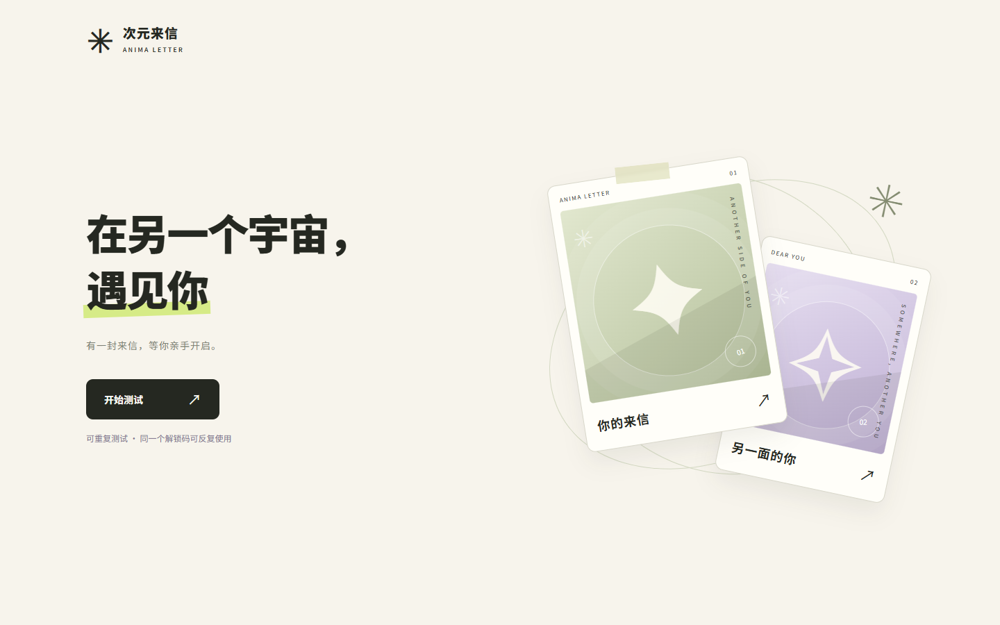

# 次元来信 · ANIMA LETTER

**一个将动漫角色匹配、故事选择和个性化来信结合起来的趣味测试网站。**

用户输入解锁码，完成一组故事情境题，就能遇见与本轮选择产生共鸣的动漫角色，了解角色所属作品，并收到一封带有真实答题依据的分析来信。来信可以回看，也能保存为 PNG 长图。

[访问网站](https://anima.wayella.com) · [本地运行](#本地运行) · [部署指南](docs/DEPLOYMENT.md) · [发货配置](docs/SALES_SETUP.md) · [匹配说明](docs/MATCHING.md)



## 这个项目提供什么

次元来信是一款面向动漫爱好者的**互动娱乐数字产品**，以网页承载体验，以解锁码交付使用权限。适合用于趣味自我探索、朋友之间的结果分享，以及角色与作品发现。

| 功能 | 当前实现 |
| --- | --- |
| 角色匹配 | 58 部作品、249 位入选角色，可选男性、女性或不限性别 |
| 故事情境 | 2000 道题，覆盖世界探索、立场与代价、羁绊与协作、能力与危机、线索与成长、舞台与日常 |
| 三种题量 | 36 题「故事初章」、60 题「完整来信」、90 题「长篇旅程」；默认 60 题 |
| 作答体验 | 选完自动前进，可返回修改、中途暂存并继续 |
| 结果来信 | 角色名字与作品、人物介绍、共鸣与差异、六类解读、日常练习和答题回顾 |
| 保存分享 | 当前浏览器最近 20 次结果回看；正文导出为 1080 像素宽的 PNG 长图 |
| 解锁与交付 | 六位数字码、重复使用、独立浏览器记录、批量发码和受认证的订单发码接口 |

2000 道题包含场景变化和复用选项。匹配与来信由服务器上的规则和编辑文案生成，运行时无需大模型 API 或 API Key。角色解读属于趣味探索，不作为心理诊断或经验证的心理测量结果。

## 用户如何使用

```text
收到网站链接与解锁码
          ↓
开始测试，输入解锁码
          ↓
选择角色性别范围与题量
          ↓
完成故事情境题
          ↓
揭晓角色，阅读来信
          ↓
回看历史 / 保存长图 / 再测一次
```

- 无需注册，也不收集手机号或邮箱。每次开始新测试都需输入解锁码，同一码可以反复使用。
- 共享一个码的浏览器各有独立记录；解锁码不会将这些记录合并。
- 清除网站数据、退出、更换浏览器或会话失效后，无法仅凭解锁码恢复原浏览器的来信。建议将重要结果保存为长图。

## 本地运行

需要 **Node.js 24+**；安装依赖与部署推荐使用 **pnpm 11**。项目已有锁文件。

```bash
git clone https://github.com/xiguajiushiwo/anime-atlas.git
cd anime-atlas
pnpm install --frozen-lockfile

# 生成并导入本地解锁码，终端会显示 codes.txt 的位置
pnpm codes --count 5 --local --site http://127.0.0.1:4173

# 启动网页和本地 API
pnpm dev
```

打开 <http://127.0.0.1:4173>，使用生成的 `codes.txt` 中的一条码进入测试。`--local` 只影响本地 SQLite 数据库，不修改线上数据库。仅运行本地服务和自动测试，也可以直接使用 `node scripts/dev.mjs` 与 `node --test tests/*.test.mjs`，无需 Cloudflare 登录。

当前仓库为私有仓库，克隆需要访问权限。线上网站的访问权限与 GitHub 仓库权限相互独立。

## 技术实现

| 部分 | 实现 |
| --- | --- |
| 页面 | 原生 HTML、CSS、JavaScript；适配桌面与手机 |
| API | Cloudflare Workers；静态资源与 API 同源 |
| 数据 | 线上使用 Cloudflare D1，本地使用 Node.js 内置 SQLite |
| 匹配 | 八维选择倾向、角色独立参数、服务端计算 |
| 会话 | HttpOnly Cookie、服务端解锁校验与频率限制 |
| 长图 | 浏览器 Canvas 本地绘制与下载 |
| 测试 | Node.js 内置测试框架及真实选项的角色可达性样本 |

只有 `public/` 对外提供静态文件。题库、评分参数、数据库、发货配置和密码清单不作为网页资源发布。

## 工程目录

```text
anime-atlas/
├── public/       # 页面、样式、交互与长图导出
├── data/         # 角色资料、入选名单、题库与题量模式
├── server/       # 解锁、匹配、来信、会话和发码逻辑
├── worker/       # Cloudflare Worker 入口与定时清理
├── scripts/      # 本地启动、发码、名单导出和维护检查
├── tests/        # 自动测试及角色可达性样本
├── migrations/   # 已发布数据库的一次性升级文件
├── docs/         # 部署、发货、匹配规则和验证记录
├── schema.sql    # 新数据库结构
└── wrangler.jsonc
```

本地运行产生的 `work/`、依赖 `node_modules/`、Wrangler 缓存和环境密钥文件均被 Git 忽略。`work/codes/` 是发货资料，`work/local.sqlite*` 是本地数据，不能当作普通缓存删除。

## 检查与维护

```bash
pnpm test                 # 权限、发码、报告和角色可达性检查
pnpm roster               # 更新 docs/CHARACTER_ROSTER.md
pnpm build:check          # 仅检查 Worker 打包，不发布
pnpm package              # 将当前 Git 提交打包到 work/exports/
```

修改人物参数或评分规则后，需重新检查角色可达性，详见 [开发与维护](docs/DEVELOPMENT.md)。部署使用 `pnpm deploy`；GitHub 推送目前不会自动部署。已有站点与新站点的数据库操作不同，请按 [部署指南](docs/DEPLOYMENT.md) 执行。

## 当前边界

- 网站已部署；批量解锁码和按订单发码接口已实现。真实店铺收款核验、小红书订单回调、买家消息发送及自动退款撤码尚未接通。
- 代码支持同一码多次、多浏览器使用，不是一次性卡密或一人一码绑定系统。
- 当前测试使用现有动漫角色。《雾灯航线》原创设定是仓库外的独立素材项目，尚未接入当前测试。
- 角色及作品相关权利归各自权利人所有；资料来源不等于商业授权。本仓库未附开源许可证。

## 进一步阅读

| 文档 | 内容 |
| --- | --- |
| [开发与维护](docs/DEVELOPMENT.md) | 文件依赖、常用命令、数据保留与清理范围 |
| [部署指南](docs/DEPLOYMENT.md) | Cloudflare 配置、新建数据库与现有站点更新 |
| [发货配置](docs/SALES_SETUP.md) | 密码库存、订单接口、重发和停用 |
| [匹配与报告规则](docs/MATCHING.md) | 抽题、匹配、个性化来信及适用边界 |
| [角色名单](docs/CHARACTER_ROSTER.md) | 当前入选角色与资料依据 |
| [验证记录](docs/VALIDATION.md) | 已完成检查及尚未验证的部分 |
